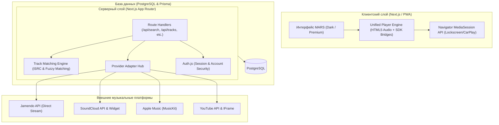

# Архитектура MARS

## 1. Обзор архитектуры

MARS спроектирован по модульному принципу с разделением ответственности:



---

## 2. Слой абстракции музыкальных провайдеров (`IMusicProvider`)

Каждый музыкальный сервис реализует единый интерфейс:

```typescript
export interface PlaybackInfo {
  type: 'direct_stream' | 'iframe_widget' | 'sdk_bridge' | 'external_url';
  streamUrl?: string;       // Для прямого воспроизведения (Jamendo)
  embedUrl?: string;        // Для iframe виджетов (SoundCloud, YouTube)
  externalUrl?: string;     // Для перехода в официальное приложение
  quality?: string;
  format?: string;
}

export interface ProviderTrack {
  providerId: string;
  providerTrackId: string;
  isrc?: string | null;
  title: string;
  artistName: string;
  albumTitle?: string | null;
  durationMs: number;
  artworkUrl?: string | null;
  isExplicit: boolean;
  versionType?: 'original' | 'remix' | 'live' | 'acoustic' | 'instrumental' | 'clean';
  sourceVersion?: string | null;
  playback: PlaybackInfo;
}

export interface IMusicProvider {
  readonly id: string;
  readonly name: string;
  readonly isPlaybackSupported: boolean;

  searchTracks(query: string, limit?: number): Promise<ProviderTrack[]>;
  getTrackDetails(providerTrackId: string): Promise<ProviderTrack | null>;
  getPlaybackSource(providerTrackId: string): Promise<PlaybackInfo>;
}
```

---

## 3. Механизм сопоставления композиций (Matching Engine)

Когда поиск возвращает результаты из нескольких провайдеров, движок объединяет их в единые записи `Track`:

1. **Первичный ключ сопоставления — ISRC (International Standard Recording Code):**
   - Если два источника возвращают один и тот же ISRC — это гарантированно одна и та же запись.
2. **Вторичное сопоставление (Эвристика нормализации метаданных):**
   - Нормализация строк: приведение к нижнему регистру, удаление знаков пунктуации, удаление суффиксов `[Remastered]`, `(Explicit)`, `(Official Audio)`.
   - Проверка длительности трека (разница $\le 3-5$ секунд).
   - Сравнение совпадения имени исполнителя и названия через расстояние Левенштейна / Jaro-Winkler ($\ge 0.9$).
3. **Приоритет версий:**
   - Предпочтение отдаётся оригинальным версиям с пометкой `explicit = true` перед clean/radio edit (в соответствии с разделом 7 ТЗ).

---

## 4. Единый аудиоплеер (Unified Player Core)

Плеер поддерживает различные типы воспроизведения:
1. **Direct Stream (HTML5 Audio):**
   - Прямой стриминг MP3/AAC/OGG (например, Jamendo).
   - Полный контроль над громкостью, таймлайном, предзагрузкой, буферизацией и эквалайзером.
2. **Widget / SDK Bridges:**
   - SoundCloud Widget API (`SC.Widget`), YouTube IFrame API, Apple MusicKit JS.
   - Скрытые/минимизированные контейнеры с синхронизацией состояния плеера (play/pause/seek/duration/volume).
3. **MediaSession API:**
   - Системный контроллер воспроизведения на экране блокировки смартфона, шторке уведомлений и мультимедийных клавишах клавиатуры.
